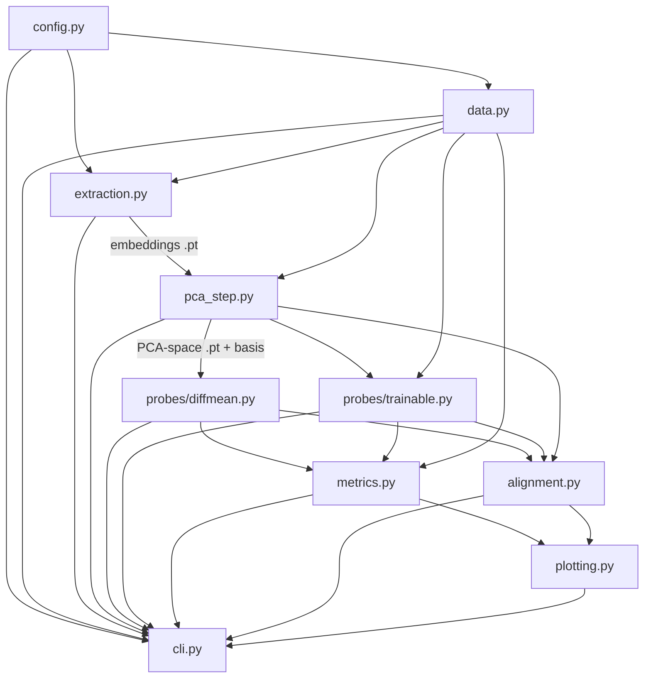

# REPOSITORY DESIGN — rq-representation-replication

## 1. Relationship to the upstream repository

**Decision: separate course-project repository; vendor the four reusable upstream `.py` files with attribution; keep the upstream clone as a read-only reference (not a submodule, not forked into our tree).**

Why not extend upstream directly:
- Its training entry point crashes on its own shipped dataset (`dev` vs `validation` split naming — MASTER_PLAN §4.1 #8).
- It is notebook-centric: analysis lives in notebooks with hardcoded private paths (`Hong-*`, `embeddings_synthetic_last`); two referenced notebooks are gitignored and not public.
- A course deliverable needs `uv` locking, tests, config files and a CLI — none exist upstream.

Why not a full rewrite of everything: the upstream probe math (diffMean, logistic/hinge trainer, Hanley–McNeil CI, map-back einsum) is correct and verified against paper App. B. We vendor `linear_model_training/{dataset,model,trainer,utils}.py` + the metric functions with an attribution header ("adapted from ruyi101/rq-representation-probing, MIT/Apache unknown — no LICENSE file present; used for academic reproduction with citation") and apply only the minimal fixes listed in MASTER_PLAN §4.1.

## 2. Final directory structure

```text
rq-replication/
├── configs/
│   └── experiment.yaml            # single source of experiment truth (schema §5)
├── data/
│   ├── raw/RQ.csv                 # verbatim copy of upstream data/RQ.csv
│   └── raw/sraq/                  # optional Tier 3 (from Abby-OGV/sraq, JSONL)
├── src/rq_probe/
│   ├── config.py                  # YAML → dataclasses; defaults from audit
│   ├── data.py                    # CSV load, split mapping (dev→validation), validation
│   ├── extraction.py              # batched hidden-state extraction, pooling, resume
│   ├── pca_step.py                # per-layer PCA, fit_split option, basis I/O
│   ├── probes/
│   │   ├── diffmean.py            # train-split class means, direction
│   │   └── trainable.py           # vendored logistic/hinge trainer (attribution)
│   ├── metrics.py                 # AUROC + Hanley–McNeil, Spearman+bootstrap, Jaccard
│   ├── alignment.py               # cosine/Spearman/Jaccard across probes; PCA map-back
│   ├── plotting.py                # Fig-1/Fig-2 style plots
│   └── cli.py                     # `rq-probe validate|extract|pca|train|evaluate|analyze`
├── scripts/                       # thin argparse wrappers over cli.py (Colab entry points)
├── tests/                         # pytest, CPU-only, synthetic fixtures
├── notebooks/                     # exploratory only; all paper logic lives in src/
├── outputs/                       # gitignored; layout §6
│   ├── embeddings/ ├── pca/ ├── probes/ ├── metrics/ └── figures/
├── docs/                          # the six planning documents
├── pyproject.toml  ├── uv.lock  ├── .gitignore  ├── README.md  └── LICENSE
```

## 3. Module responsibilities and dependencies



- `data.py` — load CSV, map split names {`dev`,`val`,`validation`}→`validation`, validate (schema, unique sequential ids, no empty text, label ∈ {0,1}, per-split distribution, `label`≡`binary_label`), return ids/labels/splits. CPU-only.
- `extraction.py` — tokenize with truncation, batch, forward with `output_hidden_states`, gather last-valid-token per example (via attention-mask sum) and masked mean; fp16 on T4; periodic `.pt` shards + `resume` by example count; writes model/dataset metadata.
- `pca_step.py` — per-layer sklearn PCA (float32, CPU); `fit_split: all|train` (all = published protocol, train = leakage-controlled); saves compressed tensor + basis (components, means, explained_variance_ratio).
- `probes/` — diffMean (train split, µ⁺−µ⁻); trainable = vendored trainer with fixes (split mapping, single load, seeds, AUROC added to output).
- `metrics.py` — AUROC (sklearn) + Hanley–McNeil 95% CI (exact port); Spearman + bootstrap CI (2000, seed 0, unit = examples); Jaccard top/bottom-20% via `argpartition` (port).
- `alignment.py` — unit-normalize directions, layer-wise cosine; PCA map-back `w_x = Wᵀw_z`, `b_x = b − w_xᵀµ` (App. B); transfer projections in original space, test-split only.
- `plotting.py` — layer-wise AUROC grid (Fig. 1 style), cosine/Spearman/Jaccard curves (Fig. 2 style).

## 4. CLI design

One command per pipeline stage, each idempotent and independently runnable (GPU stages resumable):

```bash
uv run rq-probe validate   -c configs/experiment.yaml          # CPU
uv run rq-probe extract    -c configs/experiment.yaml          # GPU, resumable
uv run rq-probe pca        -c configs/experiment.yaml [--fit-split train]   # CPU
uv run rq-probe train      -c configs/experiment.yaml --probe diffmean|logistic|hinge
uv run rq-probe evaluate   -c configs/experiment.yaml          # AUROC tables
uv run rq-probe analyze    -c configs/experiment.yaml          # alignment metrics
uv run rq-probe figures    -c configs/experiment.yaml
```

## 5. Configuration schema (`configs/experiment.yaml`)

Defaults below are **code-audited values**, not guesses; `null` fields are decided at implementation time (see §7).

```yaml
experiment:
  name: rq_replication
  seed: 42                       # upstream train.py seed, extended to all stages

dataset:
  name: RQ
  file: data/raw/RQ.csv
  text_column: question_with_context
  label_column: binary_label
  split_column: dataset          # values train/dev/test; dev mapped to validation

model:
  checkpoint: Qwen/Qwen3-4B      # primary; fallback Qwen/Qwen3-8B (+load_in_8bit)
  revision: null                 # pin exact HF revision at M3
  dtype: float16                 # T4 has no bf16; upstream "auto"→bf16 unusable
  device: auto

representation:
  pooling: last_token            # second run: mean_token (attention-mask weighted)
  selected_layers: all           # L+1 = 37 tensors for Qwen3-4B (36 layers + embedding)
  batch_size: 16                 # pilot decides; conservative start
  max_length: 512                # upstream had none; RQ avg 38.9 Llama-tokens (P §3.1)

pca:
  enabled: true
  n_components: 64               # paper §3.2 / Fig. 1
  fit_split: all                 # published protocol; 'train' = leakage-controlled variant

probes: [diffmean, logistic, hinge]
probe_hparams:                   # upstream train.py defaults [UNVERIFIED vs paper]
  lr: 0.1
  weight_decay: 0.0
  batch_size: 256
  max_epochs: 1000
  patience: 20
  early_stopping_metric: dev_loss

evaluation:
  primary_metric: auroc
  ci: hanley_mcneil              # + bootstrap in Tier 3
  jaccard_frac: 0.2              # paper Fig. 2 (upstream transfer used 0.1 — resolved)
  spearman_bootstrap: {n: 2000, seed: 0}
```

## 6. Artifact storage and naming

Every `.pt`/`.jsonl` artifact embeds a metadata dict: model checkpoint + HF revision, dataset SHA-256, split, text column, pooling, dtype, layer count, PCA config, probe type + hparams, seed, package versions, UTC timestamp.

```text
outputs/embeddings/{dataset}_{column}_{model}_{pooling}.pt        # [N, L+1, D] fp32 + meta
outputs/embeddings/{...}.resume.json                              # completed-example count (shards merged on finish)
outputs/pca/{...}_pca{K}_fit-{fit_split}.pt                       # [N, L+1, K] + meta
outputs/pca/{...}_pca{K}_fit-{fit_split}_basis.pt                 # components [L,K,D], means [L,D], evr [L,K]
outputs/probes/{...}_pca{K}_fit-{fit_split}_{probe}.pt            # W [L,K], b [L], hparams, history, metrics
outputs/metrics/auroc_{...}.jsonl  alignment_{...}.jsonl          # one record per (model, layer, probe[, pair])
outputs/figures/fig1_auroc.png  fig2_alignment.png ...
```

Row alignment invariant enforced everywhere: embedding row *i* ⇔ CSV row with `id == i`; every consumer re-checks `ids.max() < N` and join-by-id (inherited from upstream `dataset.py`, which got this right).

## 7. Open design points (resolved during implementation, recorded in REPRODUCTION_DECISIONS.md)

- Exact `uv`-pinned versions of torch/transformers/sklearn — chosen and smoke-tested on Colab in Milestone 1–3; no version is claimed compatible before that test.
- `revision` pin for Qwen/Qwen3-4B — set to the hash current at M3.
- Whether probe AUROC is also computed from **original-space** map-backed directions as a sanity check (cheap; likely yes, Tier 2).
